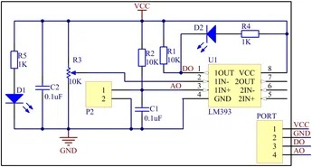

## [LM393 - модуль датчика влажности почвы](https://duino.ru/datchik-vlazhnosti-pochvy--gigrometr-.html/?ysclid=mvxx5qe16608856773)

Модуль влажности на компараторе LM393 обычно используется в проектах с Arduino и имеет два выхода: аналоговый (A0) для точных измерений и цифровой (D0) для простого срабатывания по порогу. Программирование сводится к считыванию сигналов с этих выходов и их обработке. 

Подключение модуля к Arduino:

```
VCC модуля — к 5V Arduino;
GND модуля — к любому из GND Arduino;
A0 модуля  — к аналоговому пину Arduino (например, A0);
D0 модуля  — к цифровому пину Arduino (например, 8).
```



#### Программирование для аналогового выхода

В этом режиме вы получаете непрерывные данные о влажности. Пример скетча:

```
// Аналоговый вход
// [1](https://lastminuteengineers.com/soil-moisture-sensor-arduino-tutorial/)
// [7](https://arduinoplus.ru/testiruem-pochvu-s-arduino-i-datchikom-vlazhnosti-fc-28/)

#define sensorPin A0 

void setup() 
{
  Serial.begin(9600);  // Инициализация последовательного порта
  pinMode(sensorPin, INPUT);
}

void loop() 
{
  int sensorValue = analogRead(sensorPin); // Чтение значения с датчика
  Serial.println(sensorValue);             // Вывод в монитор последовательного порта
  delay(1000);                             // Задержка для обновления
}
```

#### Калибровка

Калибровка нужна для точного использования. Для этого измерьте значения в сухой и влажной почве, чтобы определить пороговые точки. 

#### Программирование для цифрового выхода

Здесь логика проще: датчик выдаёт только два состояния — «почва сухая» (HIGH) или «почва влажная» (LOW). Порог срабатывания задаётся встроенным потенциометром на модуле. 

Калибровка: вставьте датчик в почву, когда растение нуждается в поливе. Медленно крутите потенциометр по часовой стрелке, пока светодиод на модуле не загорится. Затем чуть против часовой стрелки, чтобы светодиод только что погас — так вы установите порог. 

Пример скетча:

```
// [1](https://lastminuteengineers.com/soil-moisture-sensor-arduino-tutorial/)

#define sensorPower 7  // Пин для включения питания модуля
#define sensorPin A0   // Аналоговый пин 

void setup() 
{
  pinMode(sensorPower, OUTPUT);
  digitalWrite(sensorPower, LOW);  // Выключаем модуль изначально
  Serial.begin(9600);
}

void loop() 
{
  int sensorValue = analogRead(sensorPin);
  Serial.print("Analog: ");
  Serial.println(sensorValue);

  // Логика на основе цифрового выхода
  if (sensorValue < 300) 
  {  // Пример порога
    Serial.println("Статус: слишком влажно");
  }
  else if (sensorValue >= 300 && sensorValue < 600) 
  {
    Serial.println("Статус: нормально");
  } 
  else 
  {
    Serial.println("Статус: слишком сухо - пора поливать!");
  }
  delay(1000);
}
```

#### Рекомендации

Аналоговый выход подходит для точного мониторинга, например, для системы капельного полива. 

Цифровой выход удобен для простых задач, например, включения/выключения реле. 

Калибровка — ключевой этап. Неверная настройка потенциометра приведёт к ложным срабатываниям или пропуску полива. 

#### Библиотека. 

Для упрощения работы с LM393 на Arduino и ESP8266/NodeMCU можно использовать готовую библиотеку ***HygroSensor***. 

#### [HygroSensor](https://github.com/rennancockles/HygroSensor?ysclid=mvxwz4d03109048234)

#### [Как настроить порог срабатывания LM393]

Порог срабатывания модуля на LM393 (чаще всего это модули типа YL‑69/YL‑38 для влажности почвы) настраивается потенциометром прямо на плате — он задаёт опорное напряжение для компаратора.

- ***Как настроить порог по светодиоду-индикатору (самый простой способ)***

Подключите модуль к питанию (VCC и GND), DO можно пока не подключать или подключить к Arduino. Должен загореться светодиод питания.

Вставьте щупы в почву в том состоянии, когда вы хотите срабатывания (например, когда почва уже сухая и пора поливать).

Медленно крутите потенциометр плоской отвёрткой:

По часовой стрелке — порог смещается в сторону «более сухой» почвы (срабатывание при большем сопротивлении).

Против часовой стрелки — в сторону «более влажной» почвы.
Добейтесь, чтобы светодиод состояния (DO LED) только-только загорелся при нужной влажности.

Затем чуть поверните против часовой стрелки, чтобы светодиод погас — теперь модуль сработает, как только почва станет чуть суше этого уровня.

- ***Настройка с Arduino (по аналоговым значениям)***

Если хотите опираться на цифры и логику в коде, а не только на светодиод:

Подключите AO к аналоговому пину (например, A0) и запустите скетч:

```
void setup() 
{
  Serial.begin(9600);
}

void loop() 
{
  int val = analogRead(A0);
  Serial.println(val);
  delay(500);
}
```

Запишите значения в двух состояниях:
в сухой почве (например, 700–900),
в хорошо увлажнённой (например, 300–500).

Выберите порог посередине или чуть ближе к нужному состоянию (например, 550).

Теперь крутите потенциометр, пока при целевой влажности значение на DO не переключится, и сверяйте с показаниями AO.

Важно: у разных типов почвы и разной воды (с минералами/удобрениями) сопротивление отличается, поэтому калибровать нужно именно в ваших условиях.

***Нюансы, которые влияют на порог***

- Тип почвы. Песок, глина, торф дают разные сопротивления — один и тот же порог будет работать по-разному.

- Износ и окисление щупов. Со временем сопротивление меняется, поэтому порог стоит периодически проверять.

- Напряжение питания. Если модуль питается от 3,3 В вместо 5 В, диапазон значений AO и логика компаратора немного сместятся.

- Длительность контакта. Не держите щупы в почве слишком долго при калибровке — металл может поляризоваться и искажать показания.

***Что делать, если порог «плавает»***

Очистите щупы от налёта (мягкой щёткой, можно слабым раствором уксуса, потом тщательно промыть и высушить).

Проверьте надёжность контактов и отсутствие окислов на плате.

Убедитесь, что питание стабильное и нет наводок (не кладите рядом силовые провода).

### Библиография

#### [Датчик влажности почвы для Arduino](https://ampero.ru/product/datchik-vlazhnosti-pochvy-dlya-arduino?ysclid=mvxsozj2aw880642688)

#### [Подключение датчика влажности почвы к Ардуино](https://роботехника18.рф/датчик-влажности-почвы/?ysclid=mvxvyr697s163197069)

#### [Тестируем почву с Ардуино и датчиком влажности FC-28](https://arduinoplus.ru/testiruem-pochvu-s-arduino-i-datchikom-vlazhnosti-fc-28/)

#### [How Soil Moisture Sensor Works and Interface it with Arduino](https://lastminuteengineers.com/soil-moisture-sensor-arduino-tutorial/)

#### [4.3. Подключаем датчик влажности почвы](https://amegakit.ru/blogs/blog/43-podklyuchaem-datchik-vlazhnosti-pochvy)


