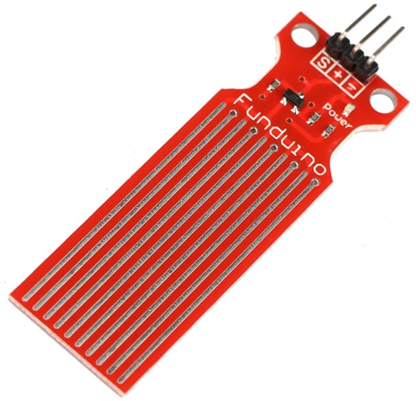
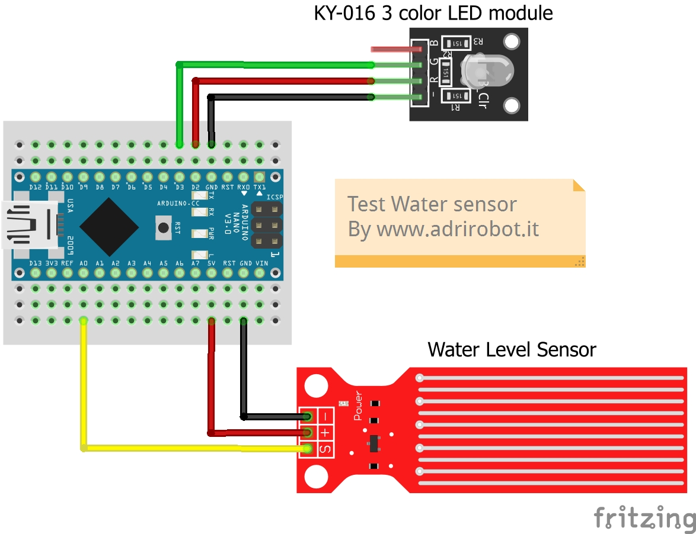

## [Water Level Sensor - датчик уровня воды](https://fritzing.org/projects/test-water-sensor)

### [Тест датчика уровня воды](water_sensor_test/water_sensor_test.ino)

### Библиография

#### [eGizmo-Fritzing](https://github.com/e-Gizmo/eGizmo-Fritzing/tree/master)

#### [Пример 29. Датчик уровня воды](https://ampermarket.kz/base/ex29-water-level-sensor/?ysclid=mvxtdap47g296185060)

#### [Подключение датчик уровня воды к Arduino: Схема и пример кода](https://voltiq.ru/water-level-sensor-arduino-connection/?ysclid=mvxtpxjqu7477736693)

